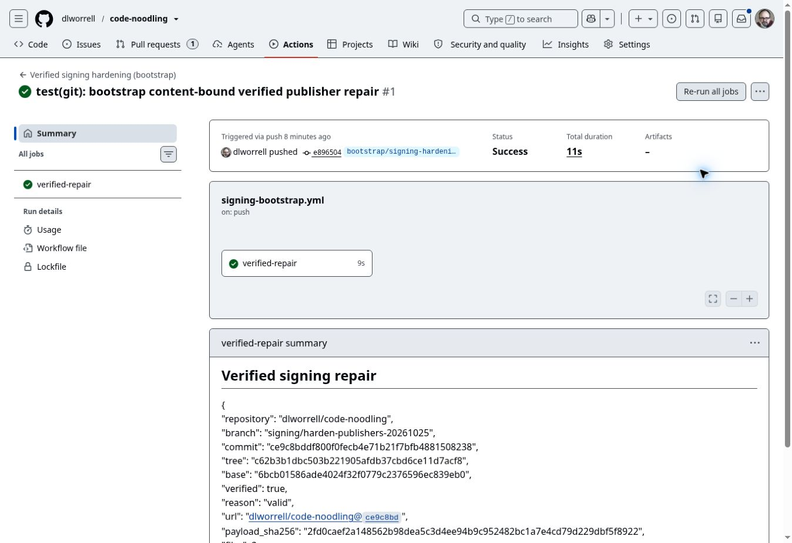

# Git and patch signing remediation — 2026-10-25

Status: five verified repair PRs are open for maintainer review. The two observed unsigned PR heads have been replaced. This is source and hosted-check evidence, not independent human approval or blanket certification.

The accepted Catylist inventory at 7a1ede0 defines the 17 repositories audited. All 17 current default tips were checked through GitHub and report verified=true, reason=valid. The source review read 102 workflows, 92 unique blobs across 111 locations, and the five actual GitHub commit publishers. Eight external-reference repositories were excluded. Private repository source contents and workflow paths are omitted from this public record.

## Instruction and authority

The requested Dropbox Git prompt was read from /prompt/github-dlworrell/agency-agents/engineering/engineering-git-workflow-master.md, revision 65eacc6d2803601b90224. Its atomic commits, safe branching, CI and leased updates were applied. Its generic squash/rebase examples do not override accepted Catylist ADR-0006: verified landing commits, PRs and merge-only default history. No repository settings were changed.

ADR-0007 was already adopted by [Catylist #38](https://github.com/dlworrell/Catylist/pull/38). This repair does not repeat or reopen that adoption. Historic unsigned default history was left intact; current requirements apply to new landing commits.

## Removed signature blockers

| PR | Unsigned head replaced | Verified head | Current result |
|---|---|---|---|
| [dlworrell/code-noodling #72](https://github.com/dlworrell/code-noodling/pull/72) | de2f0a8cf0ce1ce25bc7c13800b82739c213c95a | dcb0816ae400c3ae33fa1915fea3b627fef08191 | Merged by maintainer at 6bcb01586ade4024f32f0779c2376596ec839eb0 |
| [dlworrell/atarix #58](https://github.com/dlworrell/atarix/pull/58) | 9edd9014fb70d1a6e50db4b4706d1cd6743125e4 | b0a8d13e5dccf574076e322dba0d9e082b76bb6a | Open; mergeable, clean; Proposed ADR unchanged |

Code-noodling #72 retains the exact reviewed tree. ATARIX #58 retains its original one-file ADR content and was based on the latest default tip, preserving intervening default history. Both replacement heads were verified through GitHub before updating their existing PR branches with a lease. Signing runs are retained in the machine record.

## Permanent publisher repairs

| Repository and PR | Verified head | Focused tests | Hosted checks at capture |
|---|---|---:|---|
| [dlworrell/repo_templates #12](https://github.com/dlworrell/repo_templates/pull/12) | 45143268deceab2f6a9c664a7e68c68ec6c0bb52 | 16 pass | 3 success |
| [dlworrell/evo #130](https://github.com/dlworrell/evo/pull/130) | 9bbdab947836176d4657469deeb9293ef34c788a | 16 pass | 39 success |
| [dlworrell/code-noodling #73](https://github.com/dlworrell/code-noodling/pull/73) | ce9c8bddf800f0fecb4e71b21f7bfb4881508238 | 19 pass | 4 skipped, 13 success |
| [dlworrell/atarix #62](https://github.com/dlworrell/atarix/pull/62) | da0682382bd0108aa2c33721ec854377511491aa | 6 pass | 6 success |
| [dlworrell/herkules-1934-english #7](https://github.com/dlworrell/herkules-1934-english/pull/7) | 2b5af722741c132e9329481b5f738b32b92d270c | 6 pass | 2 success, 1 in_progress |

The five PRs cover three publisher families:

- P0 helpers in repo_templates and EVO now validate the exact returned commit's GitHub signature and expected parent before reporting success. They refuse a divergent existing remediation head instead of applying a baseline delta on unrelated ancestry.
- ATARIX and Herkules publishers now validate the returned commit and parent, reject default-branch and pull_request_target publication, and update only workflow-owned automation refs using an atomic beforeOid lease.
- The code-noodling report publisher now validates commit identity, signature, exact tree and parent. An unsigned identical-content head is replaced instead of accepted as a no-op. Automation ref updates use a lease; default-branch and unsafe-event publication are rejected.

All 63 focused test executions passed locally. The tests exercise negative verification, wrong identity/parent, concurrency rejection and the known publication boundaries. Existing hosted CI is recorded per exact head in the JSON; newly added generic publisher tests were run locally. No new required checks or workflow permission settings were introduced.

EVO's first CMake/clang parity job failed while apt fetched Microsoft's package index with HTTP 403. Retrying only that failed job passed; no build or signature validation was weakened.

The ATARIX and Herkules signed publication preserved the existing executable bit. A temporary expected-tree assertion had incorrectly modeled that script as 100644; independent comparison of every tree entry confirmed only the two intended files changed, with the original 100755 mode retained, before opening the PRs. No workflow file was added in either final PR.

## Signed publishing and patch integrity

The connector's low-level commits and a sandbox Contents-API probe were observed unsigned. Those writes are unsuitable as mergeable PR heads under ADR-0006. The repair used existing owner-triggered repository Actions and GraphQL createCommitOnBranch with the existing GITHUB_TOKEN. GitHub produced verified web-flow signatures. Final heads have one expected default parent and exclude all bootstrap files and commits.

The publication payload was bound by SHA-256 and each file by its Git blob identity, followed by resulting tree, ancestry and GitHub verification checks. File blob IDs and SHA-256 digests are retained in the machine record. For a patch, verify its recorded baseline and resulting tree; a checksum binds bytes but is not a human approval. A Signed-off-by trailer is a separate assertion and does not create a cryptographic signature. No such human assertion was added.

Unsigned bootstrap branches are disposable setup only and must never be merged. They do not sit in the ancestry of the reviewed PR heads. No signing keys were generated or registered, no Working Copy installation was restored, and no default/protected branch was force-pushed.

Official API references: [GitHub GraphQL commit creation](https://docs.github.com/en/graphql/reference/commits) and [atomic ref updates](https://docs.github.com/en/graphql/reference/git). These capabilities do not replace checking the actual returned commit.

## Remaining work

Maintainer review and merge remain for the five repair PRs. ATARIX #58 still requires its architectural review; signing it did not accept the Proposed ADR. The crypto pilot remains open for its own qualification and adversarial-evidence reconciliation; #72's merge does not prove whole-pilot completion. EVO's archive milestone was already merged and is not reopened here.

[Catylist #29](https://github.com/dlworrell/Catylist/issues/29) remains open because a maintainer commit originating from the phone and merging through the sandbox has not been observed. Working Copy is retired. The existing signed web/agent route is evidenced, but it does not establish phone-origin client proof. That proof or an explicit maintainer revision of the client-specific criterion remains necessary. Broader conformance rollout is tracked separately in Catylist #23/#27.

## Default tip verification snapshot

| Repository | Default commit | Signature |
|---|---|---|
| dlworrell/Catylist | 7a1ede0bb073477be226aa572fc3c20db3312df1 | verified / valid |
| dlworrell/AES | 2a29348533bbc29f9e645c45316bcce33d75ae0c | verified / valid |
| dlworrell/AEMS | dac93871987b3234743854cc39c8b3dc89009a4d | verified / valid |
| dlworrell/P0 | 5d63e766ae6d5a6b4e82cb9b78e71871c7237da5 | verified / valid |
| dlworrell/repo_templates | f9e3f20efdf47daf7536759c3028acda38496303 | verified / valid |
| dlworrell/engineering-docs-toolkit | 43a589fd370f6d48350e5f916cea6b2535cbd8d7 | verified / valid |
| dlworrell/EWT | 13f00199cfbd8c42a99eb4fa7fff6883603c1ee0 | verified / valid |
| dlworrell/evo | ec23d960cbf5f5271306a88442023c0107cd50ff | verified / valid |
| dlworrell/atarix | 5854e74fd6f7053571ca562c8da92302c637b090 | verified / valid |
| dlworrell/herkules-1934-english | 0bbeae193c7273cdc1cf5642c5d476fb215bd9e8 | verified / valid |
| dlworrell/JAG | fff04010fb1d4cf73e1e164c6d82570817767410 | verified / valid |
| dlworrell/MayaUSD2017Bridge | d3c72e64f0386d51c7dfc0d0af6782d187bfe7a8 | verified / valid |
| dlworrell/code-noodling | 6bcb01586ade4024f32f0779c2376596ec839eb0 | verified / valid |
| dlworrell/Just-a-Geek-LLC | b7883261ae460abeed9dae57466272f0411ca96e | verified / valid |
| dlworrell/openCUDA | 1af2228d9880f1d31f1a6833041d6621830f9cad | verified / valid |
| dlworrell/Rocket_demo | 080cc1a5d77165cd0b6844c0970019b4344ab98a | verified / valid |
| dlworrell/audiblebooks | 54bf65474f777bd9a8749a9f2d7f21814cb8196a | verified / valid |

The exact capture timestamps, source index, repaired old/new heads, signed PR trees/parents, file digests and hosted-check links are in [the machine record](GIT-signing-remediation-20261025.json). This is a time-bounded review of known publishing paths and current PR/default heads; it does not establish every historical branch or physical client's configuration.

